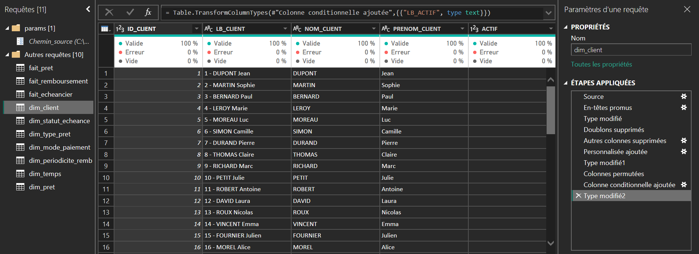

<div align="center">

# 🏦 Banque – Portefeuille de prêts

**Tableau de bord Power BI de pilotage d'un portefeuille de prêts bancaires**
Prêts · Échéancier · Remboursements · Clients


</div>

> ⚠️ **Projet d'apprentissage.** Les données sont fictives et ne représentent aucun établissement bancaire réel (voir [Limites connues](#-limites-connues)).

---

## 📑 Sommaire

1. [Aperçu du rapport](#-aperçu-du-rapport)
2. [Objectif](#-objectif)
3. [Source des données](#-source-des-données)
4. [Modèle de données](#-modèle-de-données)
5. [Mesures DAX](#-mesures-dax)
6. [Contrôles qualité](#-contrôles-qualité)
7. [Compétences démontrées](#-compétences-démontrées)
8. [Ouvrir le projet](#-ouvrir-le-projet)
9. [Limites connues](#-limites-connues)
10. [Pistes d'amélioration](#-pistes-damélioration)
11. [Structure du dépôt](#-structure-du-dépôt)
12. [Auteur](#-auteur)

---

## 📸 Aperçu du rapport

### Page de synthèse


### Pages thématiques

| Prêts | Échéancier |
|:---:|:---:|
|  |  |
| **Remboursements** | **Clients** |
|  |  |

### Modèle relationnel


---

## 🎯 Objectif

Donner une vue unique du portefeuille de prêts, de l'octroi au remboursement des échéances.

| Domaine | Questions auxquelles le rapport répond |
|---|---|
| 💶 **Prêts** | Quels volumes et montants prêtés, quel montant moyen, quelle durée, quel taux ? |
| 📅 **Échéancier** | Quel montant est prévu, en capital et en intérêts ? |
| 💳 **Remboursements** | Quels montants encaissés, par quel mode de paiement ? |
| ⏱️ **Recouvrement** | Quel taux de recouvrement, quelle part payée dans les délais, quel retard ? |
| 👥 **Clients** | Combien de clients emprunteurs, actifs, et où sont-ils ? |

Chaque indicateur est comparé à la **même période de l'année précédente (N-1)**.

### Quelques repères (sans filtre)

| Indicateur | Valeur |
|---|---:|
| Prêts / clients emprunteurs | 250 000 / 10 000 |
| Montant total prêté | 13,12 Md€ |
| Montant payé (hors copies) | 1,06 Md€ |
| Échéances échues payées dans les délais / en retard | 66,67 % / 33,33 % |
| Montant moyen d'un prêt / durée moyenne / taux moyen pondéré | 52 497 € / 89,3 mois / 5,50 % |

---

## 📊 Source des données

9 fichiers CSV (3 faits, 6 dimensions), inclus dans [`data/banque_p3_last_csv`](data/banque_p3_last_csv) et lus depuis le dossier du paramètre `Chemin_source`. Jeu de données fourni par **Martinien Raoul S. ADDA** ([source](https://www.linkedin.com/posts/martinien-adda_challenge-power-bi-concevez-un-tableau-share-7484093212773650433-34oX)). Calendrier du 01/01/2015 au 18/07/2023.

| Fait | Dernière date |
|---|---|
| Prêts | 20/03/2023 |
| Remboursements | 18/06/2023 |
| Échéancier | 18/07/2023 |

Power Query : lecture des CSV (Windows-1252 ou UTF-8), typage, dédoublonnage des dimensions sur leur clé, ajout des libellés (`LB_CLIENT`, `LB_PRET`, `LB_ACTIF`). Aucune transformation métier sur les faits.



---

## 🧱 Modèle de données

Modèle en constellation, mode Import, culture fr-FR : **3 faits**, **7 dimensions**, **19 relations** plusieurs-à-un (filtrage unidirectionnel).

```mermaid
erDiagram
    dim_client ||--o{ fait_pret : ID_CLIENT
    dim_client ||--o{ fait_echeancier : ID_CLIENT
    dim_client ||--o{ fait_remboursement : ID_CLIENT
    dim_pret ||--|| fait_pret : ID_PRET
    dim_pret ||--o{ fait_echeancier : ID_PRET
    dim_pret ||--o{ fait_remboursement : ID_PRET
    dim_temps ||--o{ fait_pret : DT_TEMPS
    dim_temps ||--o{ fait_echeancier : DT_TEMPS
    dim_temps ||--o{ fait_remboursement : DT_TEMPS
    dim_type_pret ||--o{ fait_pret : CD_TYPE_PRET
    dim_type_pret ||--o{ fait_echeancier : CD_TYPE_PRET
    dim_type_pret ||--o{ fait_remboursement : CD_TYPE_PRET
    dim_periodicite_remb ||--o{ fait_pret : CD_PERIODICITE_REMB
    dim_periodicite_remb ||--o{ fait_echeancier : CD_PERIODICITE_REMB
    dim_periodicite_remb ||--o{ fait_remboursement : CD_PERIODICITE_REMB
    dim_statut_echeance ||--o{ fait_echeancier : CD_STATUT_ECHEANCE
    dim_statut_echeance ||--o{ fait_remboursement : CD_STATUT_ECHEANCE
    dim_mode_paiement ||--o{ fait_remboursement : CD_MODE_PAIEMENT
```




### Tables

| Table | Rôle (une ligne =) | Lignes |
|---|---|---:|
| `fait_pret` | un prêt octroyé | 250 000 |
| `fait_echeancier` | une échéance théorique | 1 000 000 |
| `fait_remboursement` | un règlement d'échéance | 1 000 000 |
| `dim_client` | un client et sa localisation | 10 000 |
| `dim_pret` | un prêt (libellé, octroi, montant, taux, durée) | 250 000 |
| `dim_temps` | un jour, sans trou | 3 121 |
| `dim_type_pret` | AUTO, CONSO, IMMO, PERSO, PRO | 5 |
| `dim_periodicite_remb` | MENS, TRIM, SEM, ANN | 4 |
| `dim_statut_echeance` | ATT, REGL, RET, PART, ANN | 5 |
| `dim_mode_paiement` | CB, CHQ, ESP, PRLV, VIR | 5 |
| `_Mesure` | table dédiée aux 123 mesures DAX | – |

`dim_temps` est reliée aux 3 faits par leur propre date (octroi, échéance, règlement) : sélectionner une année filtre les trois faits en même temps.

---

## 🧮 Mesures DAX

**123 mesures**, toutes dans `_Mesure`, rangées en dossiers d'affichage (`Dashboard`, `Prets`, `Echeancier`, `Remboursement`, `Clients`, `Technique`). Chaque indicateur suit trois niveaux :

| Niveau | Contenu | Exemple |
|---|---|---|
| **1. Base** | L'indicateur lui-même | `Montant total paye` |
| **2. Comparaison N-1** | Année précédente (`LY`), variation relative (`Var %`) ou écart en points pour les taux (`PT`) | `Montant total paye LY` |
| **3. Affichage carte** | `Delta` (flèche ▲ ▼ ▶), `Couleur` (vert / rouge / neutre) | `Montant total paye var Delta` |

Les couleurs sont centralisées dans `_Couleur bon / mauvais / neutre` (dossier *Technique*). Pour les retards, la logique est inversée : une baisse est verte. Aucune mesure n'utilise `TODAY()` : le N-1 est borné à la dernière date des données.

| Mesure | Définition |
|---|---|
| `Nb prets` / `Nb clients emprunteurs` | prêts et clients distincts |
| `Montant total prete` | somme de `MONTANT_PRET` |
| `Montant total paye` / `Capital total paye` / `Interet total paye` | règlements, hors copies |
| `Montant total prevu` | échéancier |
| `Taux de recouvrement %` | payé / prévu échu |
| `Taux de paiement dans les delais` | prévu `REGL` / prévu échu |
| `Retard echeance echues %` | échéances `RET` / échéances échues |
| `Montant restant a rembourser` | prévu − payé |
| `Taux moyen pret` | taux pondéré par le montant |

👉 Détail des mesures de base : [`measures/mesures_dax.md`](measures/mesures_dax.md)

---

## ✅ Contrôles qualité

Contrôles réalisés en lecture seule par requêtes DAX sur le modèle chargé. Aucune anomalie, hormis les copies de remboursements (voir [Limites connues](#-limites-connues)).

| Domaine | Contrôle | Résultat |
|---|---|---|
| Clés | unicité de `ID_PRET`, `ID_REMB`, `ID_ECHEANCE`, `ID_CLIENT` | aucun doublon |
| Intégrité | clés orphelines sur les 18 relations faits → dimensions | 0 |
| Cohérence | remboursement (hors copies) = échéance : prêt, montant, intérêt, statut | 0 divergence |
| Cohérence | `MONTANT_PAYE` = `CAPITAL_PAYE` + `INTERET_PAYE` | 0 écart |
| Montants | valeurs ≤ 0 ; intérêt négatif ou supérieur à l'échéance | 0 |
| Dates | calendrier continu ; échéance postérieure à l'octroi | 3 121 jours sans trou ; 0 anomalie |
| Copies | lignes de remboursement en double sur une même échéance | **250 000** |

---

## 🧠 Compétences démontrées

| Domaine | Détail |
|---|---|
| **Import et nettoyage (Power Query)** | 9 requêtes CSV, source paramétrée, gestion des encodages et des locales |
| **Modélisation** | Constellation : 3 faits, 7 dimensions, 19 relations |
| **DAX** | 123 mesures : N-1 borné, taux, pondérations, couleurs conditionnelles |
| **Qualité des données** | Détection et neutralisation des doublons, batterie de contrôles d'intégrité |
| **Visualisation** | Dashboard et 4 pages thématiques |
| **Qualité du modèle** | Table de mesures dédiée, dossiers d'affichage, nommage cohérent |
| **Documentation** | README, schéma du modèle, limites chiffrées |

---

## 🚀 Ouvrir le projet

1. Récupérer les 9 CSV dans un dossier local.
2. Ouvrir le fichier `.pbix` dans **Power BI Desktop**.
3. **Accueil → Transformer les données → Gérer les paramètres**, puis renseigner `Chemin_source` avec le chemin du dossier des CSV, **sans antislash final**.
   Exemple : `C:\data\banque`
4. Cliquer sur **Actualiser**.
5. Contrôler : 250 000 prêts, 10 000 clients, 750 000 remboursements hors copies, 1 000 000 d'échéances.

---

## 🚧 Limites connues

- **Échéancier tronqué.** Chaque prêt compte 12 à 240 échéances attendues, mais seules les 4 premières sont chargées (1 000 000 sur 22 333 092 attendues, soit 4,5 %). Le prévu (1,42 Md€), le payé (1,06 Md€) et le restant (354 M€) ne portent que sur ces 4 échéances : ils ne représentent ni le capital prêté ni un encours.
- **Copies de remboursements.** `fait_remboursement` contient 250 000 lignes en double, à `ID_REMB` distincts, repérées par regroupement sur `ID_ECHEANCE`. La colonne masquée `EST_COPIE` les exclut de toutes les mesures de paiement. Les colonnes brutes `MONTANT_PAYE`, `CAPITAL_PAYE` et `INTERET_PAYE` ne sont pas protégées : elles donnent un chiffre surévalué de 33,4 %.
- **Retard et recouvrement.** Les échéances au statut `RET` sont payées intégralement, d'où un taux de recouvrement de 100 %. `Montant en retard` désigne donc des échéances payées avec retard, pas des impayés. Tous les règlements étant datés du jour de l'échéance, le retard n'existe que par le libellé du statut.
- **Données très régulières.** Chaque prêt suit le même profil (échéances 1 et 2 réglées, 3 en retard, 4 en attente) et les types, périodicités et modes de paiement sont équirépartis : les ratios sont figés et les comparaisons N-1 sont nulles.
- **Durée et périodicité incohérentes.** `NOMBRE_ECHEANCE` est égal à `DUREE_MOIS` quelle que soit la périodicité, y compris annuelle.
- **Année 2023 incomplète.** Les comparaisons N-1 sont bornées sur la dernière date de chaque fait, mais 2023 seule n'est pas comparable à une année complète.
- **Locale des montants.** Les montants sont lus avec le point décimal (en-US) ; un CSV au format français serait mal interprété.

---

## 🔭 Pistes d'amélioration

- Charger l'échéancier et les remboursements complets, ou signaler dans le rapport que prévu, payé et restant ne couvrent que les 4 premières échéances.
- Supprimer les copies dans Power Query et masquer les colonnes de montant brutes de `fait_remboursement`.
- Corriger `NOMBRE_ECHEANCE` à la source en tenant compte de la périodicité.
- Fournir une date de paiement réelle pour mesurer un retard en jours.
- Rendre `Chemin_source` et la mesure `Afficher btn` indépendants du poste.
- Désactiver Auto date/time et masquer les colonnes en double entre `fait_pret` et `dim_pret`.

---

## 📂 Structure du dépôt

```
banque-portefeuille-prets/
├── README.md                  ← ce fichier
├── .gitignore
├── banque_portefeuille.pbix   ← rapport Power BI
├── data/
│   ├── README.md              ← description des données
│   └── banque_p3_last_csv/    ← 9 fichiers CSV
├── docs/
│   ├── README.md
│   └── *.png                  ← captures du rapport et du modèle
└── measures/
    └── mesures_dax.md         ← mesures DAX documentées
```

---

## 👤 Auteur

**MAMADOU Lamarana Diallo** · [LinkedIn](https://www.linkedin.com/in/yebhe/)