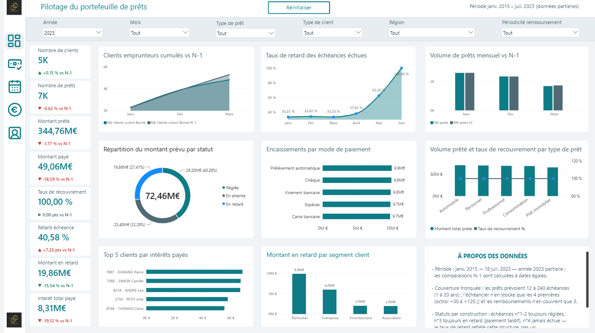
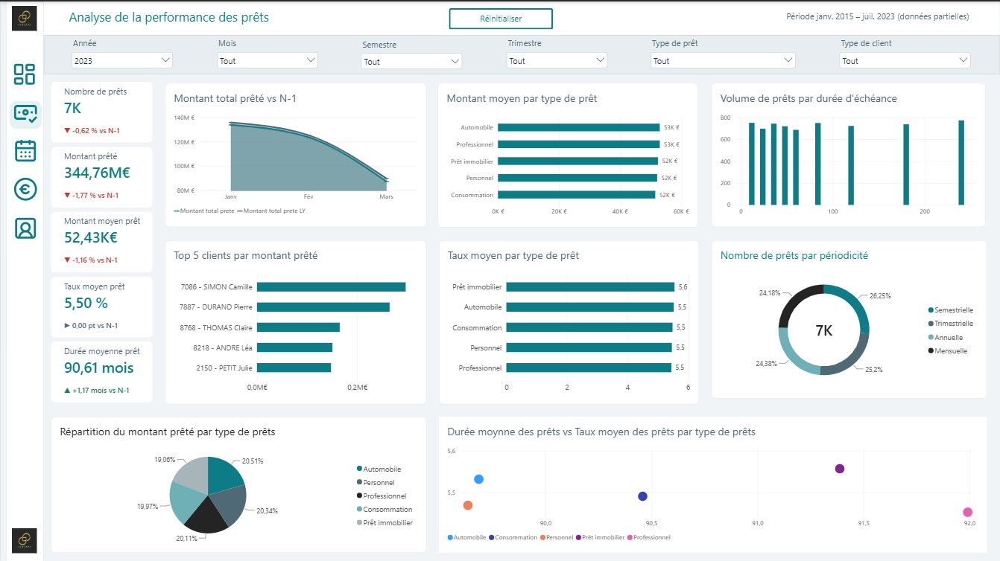
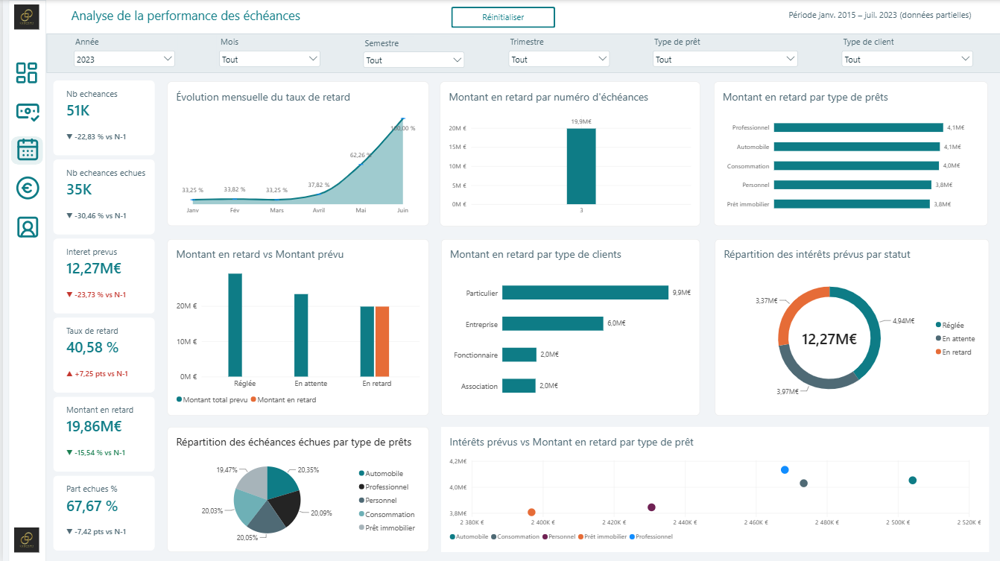
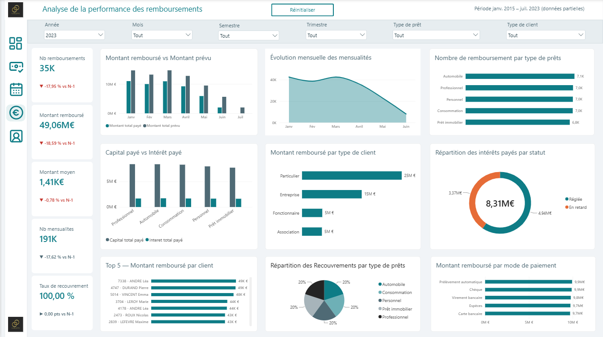
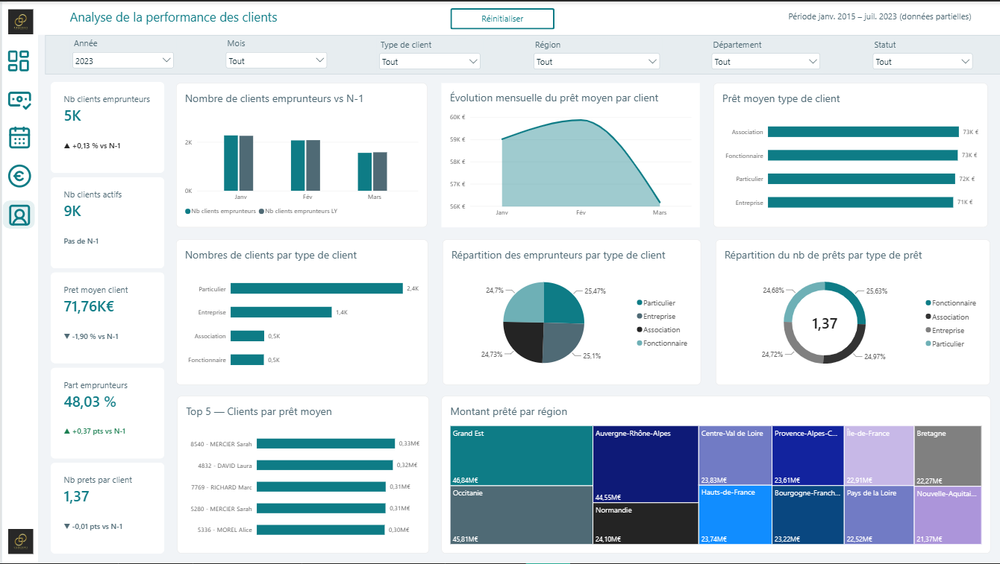
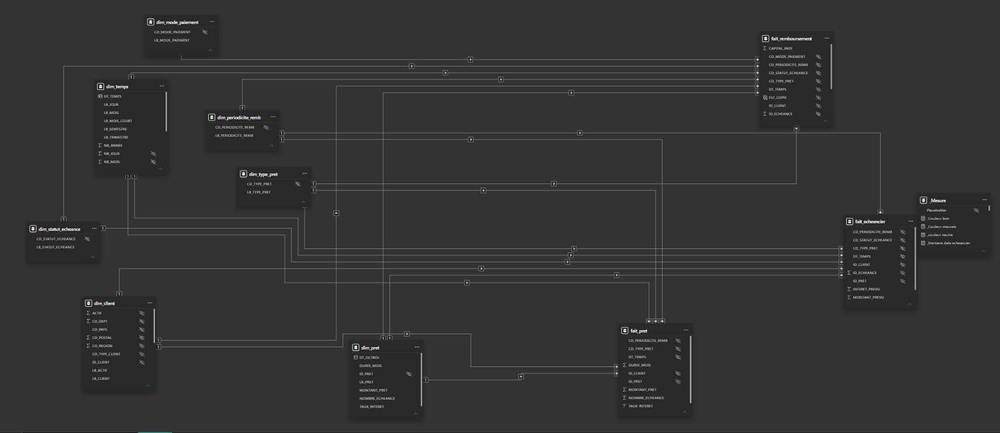

```mermaid
erDiagram
    dim_client ||--o{ fait_pret : ID_CLIENT
    dim_client ||--o{ fait_echeancier : ID_CLIENT
    dim_client ||--o{ fait_remboursement : ID_CLIENT
    dim_pret ||--|| fait_pret : ID_PRET
    dim_pret ||--o{ fait_echeancier : ID_PRET
    dim_pret ||--o{ fait_remboursement : ID_PRET
    dim_temps ||--o{ fait_pret : DT_TEMPS
    dim_temps ||--o{ fait_echeancier : DT_TEMPS
    dim_temps ||--o{ fait_remboursement : DT_TEMPS
    dim_type_pret ||--o{ fait_pret : CD_TYPE_PRET
    dim_type_pret ||--o{ fait_echeancier : CD_TYPE_PRET
    dim_type_pret ||--o{ fait_remboursement : CD_TYPE_PRET
    dim_periodicite_remb ||--o{ fait_pret : CD_PERIODICITE_REMB
    dim_periodicite_remb ||--o{ fait_echeancier : CD_PERIODICITE_REMB
    dim_periodicite_remb ||--o{ fait_remboursement : CD_PERIODICITE_REMB
    dim_statut_echeance ||--o{ fait_echeancier : CD_STATUT_ECHEANCE
    dim_statut_echeance ||--o{ fait_remboursement : CD_STATUT_ECHEANCE
    dim_mode_paiement ||--o{ fait_remboursement : CD_MODE_PAIEMENT
```

# Banque – Portefeuille de prêts

**Modèle sémantique Power BI de pilotage d'un portefeuille de prêts bancaires**
Prêts · Échéancier · Remboursements · Clients

> **Projet d'apprentissage.** Les données sont des données de démonstration (très régulières, voir [Limites connues](#limites-connues)) et ne représentent aucun établissement bancaire réel.

---

## Sommaire

1. [Aperçu du rapport](#aperçu-du-rapport)
2. [Objectif](#objectif)
3. [Source des données](#source-des-données)
4. [Modèle de données](#modèle-de-données)
5. [Power Query](#power-query)
6. [Mesures DAX](#mesures-dax)
7. [Contrôles qualité](#contrôles-qualité)
8. [Limites connues](#limites-connues)
9. [Ouvrir le projet](#ouvrir-le-projet)
10. [Pistes d'amélioration](#pistes-damélioration)
11. [Auteur](#auteur)

---

## Aperçu du rapport

### Page de synthèse

### Pages du rapport

<!-- Ajouter ici les autres pages, par exemple :  -->

### Modèle relationnel

---

## Objectif

Donner une vue unique d'un portefeuille de prêts, de l'octroi au remboursement des échéances : volumes et montants prêtés, échéancier, encaissements, recouvrement, retards et clients. Chaque indicateur est comparé à la même période de l'année précédente (N-1).

Valeurs sans filtre, relevées le 26/10/2026 (elles changent si les fichiers sources changent) :

| Indicateur | Valeur |
|---|---:|
| Prêts / clients emprunteurs | 250 000 / 10 000 |
| Montant total prêté | 13 124 169 328 € |
| Montant payé (hors copies) | 1 062 182 721,87 € |
| dont capital / intérêts | 881 819 220,99 € / 180 363 500,88 € |
| Montant prévu (4 premières échéances de chaque prêt) | 1 416 243 629,16 € |
| Taux de recouvrement | 100 % |
| Échéances échues payées dans les délais / en retard | 66,67 % / 33,33 % |
| Montant moyen d'un prêt / durée moyenne / taux moyen pondéré | 52 496,68 € / 89,33 mois / 5,50 % |

---

## Source des données

9 fichiers CSV (3 faits, 6 dimensions) lus depuis le dossier du paramètre `Chemin_source`. La période du calendrier va du 01/01/2015 au 18/07/2023, avec des fins de données différentes selon le fait :

| Fait | Dernière date |
|---|---|
| Prêts | 20/03/2023 |
| Remboursements | 18/06/2023 |
| Échéancier | 18/07/2023 |

---

## Modèle de données

Modèle en constellation, mode Import, culture fr-FR : 3 faits, 7 dimensions, 19 relations plusieurs-à-un à filtrage unidirectionnel (18 entre faits et dimensions, plus une vers une table de dates automatique masquée).

| Table | Rôle (une ligne =) | Lignes |
|---|---|---:|
| `fait_pret` | un prêt octroyé | 250 000 |
| `fait_echeancier` | une échéance théorique d'un prêt | 1 000 000 |
| `fait_remboursement` | une ligne de règlement d'une échéance | 1 000 000 |
| `dim_client` | un client (particulier, entreprise, association, fonctionnaire) et sa localisation | 10 000 |
| `dim_pret` | un prêt (libellé, date d'octroi, montant, taux, durée) | 250 000 |
| `dim_temps` | un jour, sans trou | 3 121 |
| `dim_type_pret` | AUTO, CONSO, IMMO, PERSO, PRO | 5 |
| `dim_periodicite_remb` | MENS, TRIM, SEM, ANN | 4 |
| `dim_statut_echeance` | ATT, REGL, RET, PART, ANN | 5 |
| `dim_mode_paiement` | CB, CHQ, ESP, PRLV, VIR | 5 |
| `_Mesure` | table des 125 mesures DAX | – |

Points structurants :

- `dim_temps` est reliée aux 3 faits par leur propre date (octroi, échéance, règlement) : sélectionner une année filtre les trois faits en même temps.
- `fait_echeancier` et `fait_remboursement` ne sont pas reliées directement ; elles partagent les dimensions (`dim_pret`, `dim_client`, `dim_temps`…). Dans `fait_remboursement`, `ID_ECHEANCE` permet le rapprochement avec l'échéancier.
- `dim_pret` est dérivée de `fait_pret` (relation 1 pour 1).
- `fait_remboursement[EST_COPIE]` : colonne calculée masquée qui repère les lignes en double (voir [Limites connues](#limites-connues)).
- Deux tables de dates automatiques masquées (`DateTableTemplate_…`, `LocalDateTable_…`) sont présentes ; la seconde est reliée à `dim_pret[DT_OCTROI]`.

---

## Power Query

Le paramètre `Chemin_source` (texte) contient le dossier des CSV. Les fichiers sont lus sans transformation métier sur les faits ; les dimensions sont dédoublonnées sur leur clé.

| Requête | Encodage | Opérations |
|---|---|---|
| `fait_pret` | Windows-1252 | promotion des en-têtes ; typage ; réordonnancement ; `MONTANT_PRET` en monétaire et `TAUX_INTERET` en nombre (locale en-US) |
| `fait_remboursement` | Windows-1252 | idem ; `MONTANT_PAYE`, `CAPITAL_PAYE`, `INTERET_PAYE` en monétaire (en-US) ; **aucune suppression de doublons** |
| `fait_echeancier` | Windows-1252 | idem ; `MONTANT_PREVU`, `INTERET_PREVU` en monétaire (en-US) |
| `dim_client` | UTF-8 | typage ; doublons supprimés sur `ID_CLIENT` ; `TELEPHONE_CLIENT` et `EMAIL_CLIENT` écartés ; ajout de `LB_CLIENT` (« ID - NOM PRENOM ») et `LB_ACTIF` (1 → Actif, 0 → Inactif) |
| `dim_pret` | – | référence à `fait_pret` ; sélection de 6 colonnes ; `DT_TEMPS` renommée `DT_OCTROI` ; ajout de `LB_PRET` ; doublons supprimés sur `ID_PRET` |
| `dim_temps` | UTF-8 | typage ; doublons supprimés sur `DT_TEMPS` ; `NB_JOUR` recalculé comme jour du mois |
| `dim_type_pret` | UTF-8 | promotion des en-têtes ; typage ; doublons supprimés sur le code |
| `dim_periodicite_remb` | Windows-1252 | idem |
| `dim_statut_echeance`, `dim_mode_paiement` | UTF-8 | lecture en une colonne puis découpage sur la virgule ; doublons supprimés sur le code |

À retenir :

- Les montants sont lus avec le point décimal (locale en-US) alors que le modèle est en fr-FR : un CSV au format français serait mal interprété.
- Les suppressions de doublons sur les dimensions sont silencieuses : le nombre de lignes retirées n'est pas visible depuis le modèle.
- Le découpage sur la virgule de `dim_statut_echeance` et `dim_mode_paiement` tronquerait un libellé contenant une virgule.
- Aucun nettoyage n'est fait sur les faits : leur qualité est celle des CSV, et les anomalies sont gérées dans le modèle (`EST_COPIE`, mesures).

---

## Mesures DAX

125 mesures, toutes dans `_Mesure`, rangées par dossiers d'affichage (`Dashboard`, `Prets`, `Echeancier`, `Remboursement`, `Clients`, `Technique`). Chaque indicateur suit trois niveaux :

| Niveau | Contenu | Exemple |
|---|---|---|
| 1. Base | l'indicateur | `Montant total paye` |
| 2. Comparaison N-1 | `LY` (année précédente, bornée à la dernière date des données moins 12 mois), `Var %` (variation relative) ou `PT` (écart en points pour les taux) | `Montant total paye LY`, `Montant total paye Var %` |
| 3. Affichage carte | `var Delta` / `pt Delta` (texte avec flèche ▲ ▼ ▶), `var Couleur` / `pt Couleur` (vert, rouge ou neutre) | `Montant total paye var Delta` |

Les couleurs sont centralisées dans `_Couleur bon`, `_Couleur mauvais` et `_couleur neutre` (dossier `Technique`). Pour les retards, le sens est inversé : une baisse est verte. Aucune mesure n'utilise `TODAY()`.

Mesures de base :

| Mesure | Définition | Valeur |
|---|---|---:|
| `Nb prets` | prêts distincts | 250 000 |
| `Nb clients emprunteurs` | clients distincts dans `fait_pret` | 10 000 |
| `Montant total prete` | somme de `MONTANT_PRET` | 13 124 169 328 € |
| `Montant total paye` | somme de `MONTANT_PAYE`, hors copies | 1 062 182 721,87 € |
| `Capital total paye` / `Interet total paye` | hors copies | 881 819 220,99 € / 180 363 500,88 € |
| `Montant total prevu` / `Interet prevus` | échéancier | 1 416 243 629,16 € / 240 484 667,84 € |
| `Montant total prevu echu` | prévu des échéances `REGL`, `RET`, `PART` | 1 062 182 721,87 € |
| `Taux de recouvrement %` | payé / prévu échu | 100 % |
| `Taux de paiement dans les delais` | prévu `REGL` / prévu échu | 66,67 % |
| `Retard echeance echues %` | échéances `RET` / échéances échues | 33,33 % |
| `Montant en retard` | prévu des échéances `RET` | 354 060 907,29 € |
| `Montant restant a rembourser` | prévu − payé | 354 060 907,29 € |
| `Nb echeances` / `Nb echeances echues` | échéances (toutes / échues) | 1 000 000 / 750 000 |
| `Nb remboursements` | hors copies | 750 000 |
| `Montant moyen rembourse` | payé / nb remboursements | 1 416,24 € |
| `Nb mensualites estimees` | pondération MENS 1, TRIM 3, SEM 6, ANN 12, hors copies | 4 125 000 |
| `Nb clients actifs` / `Part emprunteurs %` | clients `ACTIF = 1` / part ayant emprunté | 9 028 / 100 % |
| `Montant moyen pret` / `Duree moyenne pret` / `Taux moyen pret` | taux pondéré par le montant | 52 496,68 € / 89,33 mois / 5,50 % |
| `Pret moyen client` / `Nb prets par client` | par client emprunteur | 1 312 416,93 € / 25 |

---

## Contrôles qualité

Contrôles réalisés en lecture seule par requêtes DAX sur le modèle chargé (26/10/2026). Aucune anomalie n'a été trouvée, sauf celles signalées.

| Domaine | Contrôle | Résultat |
|---|---|---|
| Clés | unicité de `ID_PRET`, `ID_REMB`, `ID_ECHEANCE`, `ID_CLIENT` | aucun doublon |
| Clés | `ID_ECHEANCE` distincts dans `fait_remboursement` | 750 000 pour 1 000 000 de lignes : **250 000 copies** |
| Intégrité | clés orphelines sur les 18 relations faits → dimensions | 0 |
| Intégrité | client d'un remboursement = client de son prêt | 0 divergence |
| Cohérence | remboursement (hors copies) = échéance : prêt, montant, intérêt, statut | 0 divergence sur 750 000 lignes |
| Cohérence | `MONTANT_PAYE` = `CAPITAL_PAYE` + `INTERET_PAYE` (tolérance 0,01 €) | 0 écart |
| Montants | valeurs ≤ 0 ; intérêt négatif ou supérieur à l'échéance | 0 |
| Montants | plage des échéances (prévu et payé) | 26,35 € à 8 722,52 € |
| Prêts | montant, taux, durée | 5 000 à 100 000 € ; 2 à 9 % ; 12 à 240 mois ; `NOMBRE_ECHEANCE` = `DUREE_MOIS` partout |
| Dates | calendrier | 3 121 jours consécutifs, sans trou |
| Dates | échéance ≤ date d'octroi du prêt | 0 |
| Dates | règlement (hors copies) vs échéance | 750 000 réglés le jour exact de l'échéance, 0 avant, 0 après |
| Clients | clients sans prêt ; `ACTIF` vide | 0 ; 0 (9 028 actifs, 972 inactifs) |
| Géographie | pays / régions / départements ; code postal et département vides | 1 / 12 / 15 ; 0 |
| Référentiels | statuts utilisés par les faits | `ATT`, `REGL`, `RET` seulement ; `ANN` et `PART` jamais utilisés |
| Copies | groupes d'une même échéance avec montant ou date différents | 0 : les copies sont identiques à l'original |
| Copies | payé avec / sans exclusion des copies | 1 062 182 721,87 € / 1 416 468 470,45 € (+33,4 %) |

Non vérifié : les CSV d'origine (lignes lues, lignes en erreur, doublons retirés dans les dimensions), les pages et visuels du rapport, et l'actualisation (aucune actualisation lancée).

---

## Limites connues

### Durées de prêt (12 à 240 échéances) et échéances chargées (3 à 4)

| Élément | Par prêt | Total | Part de l'attendu |
|---|---|---:|---:|
| Échéances attendues (somme de `NOMBRE_ECHEANCE`) | 12 à 240 | 22 333 092 | 100 % |
| Échéances dans `fait_echeancier` | exactement 4 (n° 1 à 4) | 1 000 000 | 4,48 % |
| Remboursements (hors copies) | exactement 3 (n° 1 à 3) | 750 000 | 3,36 % |

- Un prêt de 12 échéances est couvert à 33 % (4 sur 12), un prêt de 240 échéances à 1,7 %.
- Il y a 3 remboursements et non 4 car l'échéance n° 4 est « en attente » : aucun règlement.
- Le prévu (1,42 Md€), le payé (1,06 Md€) et le restant à rembourser (354 M€) ne portent que sur les 4 premières échéances. Ils ne représentent ni le capital prêté (13,12 Md€) ni un encours.
- `NOMBRE_ECHEANCE` est égal à `DUREE_MOIS` pour toutes les périodicités, y compris annuelle : 240 échéances annuelles correspondraient à 240 ans. Cette donnée source est probablement incohérente.

### Montants en retard et taux de recouvrement de 100 %

| Statut | Échéances | Montant prévu | Montant payé (hors copies) |
|---|---:|---:|---:|
| Réglée (`REGL`, n° 1 et 2) | 500 000 | 708 121 814,58 € | 708 121 814,58 € |
| En retard (`RET`, n° 3) | 250 000 | 354 060 907,29 € | 354 060 907,29 € |
| En attente (`ATT`, n° 4) | 250 000 | 354 060 907,29 € | aucun |
| **Total** | **1 000 000** | **1 416 243 629,16 €** | **1 062 182 721,87 €** |

- `Montant en retard` est le prévu des échéances au statut `RET` : des échéances payées avec retard, intégralement. Ce n'est pas un impayé.
- `Taux de recouvrement %` = payé / prévu échu. Les échéances `RET` sont dans le dénominateur et entièrement payées, donc 100 %. L'échéance `ATT` n'est pas échue et n'y figure pas.
- `Taux de paiement dans les delais` (66,67 %) et `Retard echeance echues %` (33,33 %) sont les indicateurs qui traduisent le retard.
- `Montant restant a rembourser` correspond à l'échéance n° 4 (`ATT`). Il est égal à `Montant en retard` parce que les échéances n° 3 et n° 4 ont le même total dans les données, sans lien conceptuel.
- Le retard n'est pas mesurable par les dates : tous les règlements sont datés du jour de l'échéance. Il n'existe que par le libellé du statut.
- Chaque prêt suit le même profil (n° 1 et 2 `REGL`, n° 3 `RET`, n° 4 `ATT`, montants identiques par rang) : les ratios sont figés et leur comparaison N-1 est toujours nulle.

### Copies de remboursements (`EST_COPIE`)

`fait_remboursement` compte 1 000 000 de lignes à `ID_REMB` uniques pour 750 000 échéances réglées. Les doublons n'ont pas le même identifiant : ils ne se détectent que par regroupement sur `ID_ECHEANCE`.

| Lignes pour une même échéance | Échéances | Copies |
|---:|---:|---:|
| 1 | 537 366 | 0 |
| 2 | 179 062 | 179 062 |
| 3 | 30 059 | 60 118 |
| 4 | 3 247 | 9 741 |
| 5 | 252 | 1 008 |
| 6 | 13 | 65 |
| 7 | 1 | 6 |
| **Total** | **750 000** | **250 000** |

212 634 échéances (28,4 %) ont au moins une copie. Par rang : 83 501 copies pour l'échéance n° 1 (118 285 570,73 €), 83 267 pour la n° 2 (118 423 246,06 €), 83 232 pour la n° 3 (117 576 931,79 €), soit 354 285 748,58 € au total.

**Traitement.** `EST_COPIE` vaut VRAI quand `ID_REMB` n'est pas le plus petit de la même `ID_ECHEANCE`. Les montants et dates étant identiques dans chaque groupe, le choix de la ligne conservée ne change aucun total.

- Mesures qui excluent les copies (`EST_COPIE = FALSE()`) : `Montant total paye`, `Interet total paye`, `Capital total paye`, `Nb remboursements`, `Nb mensualites estimees`, et toutes les mesures qui en dérivent (restant, recouvrement, montant moyen, `LY`, `Var %`, `PT`).
- **Non protégés** : les colonnes visibles `MONTANT_PAYE`, `CAPITAL_PAYE` et `INTERET_PAYE`, qui donnent le chiffre brut (+33,4 %) si on les glisse dans un visuel, et tout nouveau calcul sur `fait_remboursement` écrit sans le filtre.
- `fait_echeancier` n'a aucun doublon.

### Autres limites

- 2023 est incomplète : les comparaisons N-1 sont bornées sur la dernière date de chaque fait, mais 2023 seule n'est pas comparable à une année complète.
- Données très régulières : 50 000 prêts par type, 62 500 par périodicité, 150 000 remboursements par mode de paiement, 250 000 lignes par combinaison statut / rang. Les analyses par type, périodicité ou mode de paiement ne montrent aucune différence.
- `ACTIF` est un instantané sans historique : `Nb clients actifs LY` est volontairement vide et affiche « Pas de N-1 ».
- Le taux d'intérêt est exprimé en pourcentage (2 à 9, pas 0,02 à 0,09).

---

## Ouvrir le projet

1. Récupérer les 9 CSV dans un dossier local.
2. Ouvrir le fichier `.pbix` dans Power BI Desktop.
3. Accueil → Transformer les données → Gérer les paramètres, puis renseigner `Chemin_source` avec le chemin du dossier des CSV, sans antislash final. Exemple : `C:\data\banque`.
4. Actualiser.
5. Contrôler : 250 000 prêts, 10 000 clients, 750 000 remboursements hors copies, 1 000 000 d'échéances.

---

## Pistes d'amélioration

- Charger l'échéancier et les remboursements complets, ou indiquer clairement dans le rapport que prévu, payé et restant ne couvrent que les 4 premières échéances.
- Corriger à la source `NOMBRE_ECHEANCE` en tenant compte de la périodicité (durée ÷ période).
- Fournir une date de paiement réelle distincte de la date d'échéance pour mesurer un retard en jours.
- Supprimer les copies dans Power Query, ou conserver `EST_COPIE` en la documentant comme règle de gestion ; masquer les colonnes de montant brutes de `fait_remboursement`.
- Rendre `Chemin_source` indépendant du poste (il pointe vers un dossier local d'un compte Windows).
- Masquer les colonnes en double entre `fait_pret` et `dim_pret` (`MONTANT_PRET`, `TAUX_INTERET`, `DUREE_MOIS`, `NOMBRE_ECHEANCE`).
- Désactiver Auto date/time et supprimer la relation vers `LocalDateTable_…` si `dim_temps` suffit.
- Corriger les mesures « Monatnt moyen rembourse … » (4 mesures) en « Montant moyen rembourse … ».
- Remplacer `Afficher btn`, qui dépend du nom de la machine (« LENOVO »), par un mécanisme indépendant avant diffusion.

---

## Auteur

**MAMADOU Lamarana Diallo** · [LinkedIn](https://www.linkedin.com/in/yebhe/)